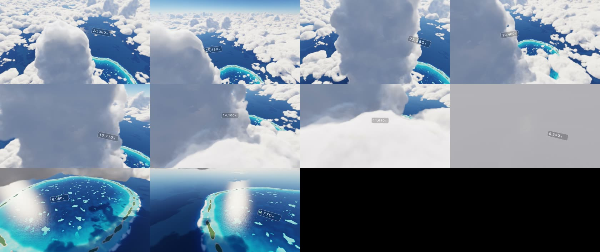

# Freefall

Apple Vision Pro 上的第一人称高空跳伞：从 30,000 英尺往下掉，穿过积云，落向一座环礁。完全沉浸，没有房间，只有天。

灵感来自小红书上一段网页作品「THIN AIR」的录屏。这里所有东西都是程序实时生成的：没有用任何贴图、模型或音频素材。



## 体验流程（约 2 分钟）

1. 开始窗口点「跳」。窗口会自己关掉，四周变成高空。
2. 从 9,144 米（30,000 英尺）开始自由落体：速度从 0 加到约 90 m/s。高空空气稀薄，越往下越慢。
3. 左前方有一座浓积云塔，下落前半段从它旁边经过。
4. 3,200 → 2,400 米穿过一层碎积云，四周一片白。
5. 穿出云底，正下方是环礁和潟湖。
6. 1,000 米淡出，开始窗口重新出现。

前方偏下、伸手可及的位置有一块高度表。风声由程序实时合成：棕噪声加带通噪声，速度越快风越大。

为了不晕：
- 镜头不会自己转，只有竖直方向的运动，想看哪里就转头。
- 开头从黑场淡入，落地前淡出。
- 建议坐着体验。

## 运行

需要 Xcode 27 和 visionOS 27 SDK，没装过 Metal Toolchain 的话先装：`xcodebuild -downloadComponent MetalToolchain`。

```bash
xcodegen generate
open Freefall.xcodeproj
```

装到头显上（头显开机、解锁，和 Mac 在同一个 Wi-Fi 里）：

```bash
tools/install-device.sh            # 编 Release 并安装
tools/install-device.sh --launch   # 装完直接启动
```

### 模拟器里不点按钮跑完整流程（只在 DEBUG 构建或模拟器里生效）

```bash
xcrun simctl launch <设备> com.feiyuchang.freefall -autoEnter YES -mute YES -lookDown 40 -timeScale 4
```

| 参数 | 作用 |
|---|---|
| `-autoEnter YES` | 启动直接跳。落完窗口重新打开后会再跳一次 |
| `-mute YES` | 不出风声 |
| `-lookDown <度>` / `-turnLeft <度>` | 模拟器里头不会动，用这两个参数让它低头、左转。只能给正数：UserDefaults 会把 `-30` 当成参数名 |
| `-startAltitude <米>` | 从别的高度开始 |
| `-timeScale <倍>` | 快进 |

## 离屏渲染检查（不开窗口、不出声）

```bash
tools/render-check/run.sh <输出目录> shots   # 12 个典型高度和朝向的截图
tools/render-check/run.sh <输出目录> perf    # 按真机分辨率（两只眼各 1888×1792）测 GPU 耗时
tools/render-check/run.sh <输出目录> seq     # 连续下落 + 转头 90 帧，查云层重投影有没有拖影
tools/render-check/run.sh <输出目录> film    # 整段下落按 90 Hz 跑，每 9 帧存一张（3 倍速预览视频的素材）
tools/render-check/run.sh <输出目录> maps    # 天气图、环礁图、云影图和大气常量
```

它在 Mac 上用和 Vision Pro 一样的方式（2 层纹理数组 + vertex amplification）跑同一份 `SceneRenderer` 和 shader。

- 环境变量 `EXPOSURE`、`SIGMA`、`STEP`、`CLOUDSCALE` 可以临时改参数。
- `METAL_DEFINES="-DPROFILE_SKIP_MARCH"` 关掉云的步进，`"-DPROFILE_FLAT_SCENE"` 关掉天空和海面着色，用来拆开量各个 pass 的耗时。

## 渲染

都在 `Freefall/Shaders/` 和 `Freefall/Shared/SceneRenderer.swift`，CompositorServices 的部分在 `ImmersiveRenderer.swift`。

**启动时算一次**
- 云的噪声：形状噪声 128³（Perlin-Worley），细节噪声 32³（Worley）。
- 天气图：64 km 平铺，存覆盖率、云顶、云底、柱状程度。
- 云顶上限图：用来在步进时跳过空段。
- 云影图：海面朝太阳方向穿过云层的光学深度。
- 环礁图。
- 大气：透射率表、多次散射表、海平面的天空表，以及几个常量。

**每帧**
1. 按头部海拔重算天空视图表（192×108）。
2. 新算云样本（四分之一大小）：云层分辨率是渲染分辨率的一半，每帧只重算 2×2 块里的一个像素。起步抖动每帧换。
3. 云层合成：其余三个像素用刚算出的云深度投到上一帧取历史，再夹到周围新样本的范围里，避免拖影。
4. 主 pass：天空和太阳；海面（噪声高度场的浪，加上 Beckmann 统计粗糙度的太阳倒影）；环礁（浅水按深度吸收红光、沙洲、白浪）；合成云层；ACES 色调映射；抖动。
5. 高度表：CoreText 生成的字形图集。

**参考**
- 大气：Hillaire 2020《A Scalable and Production Ready Sky and Atmosphere Rendering Technique》，写法照 [sebh/UnrealEngineSkyAtmosphere](https://github.com/sebh/UnrealEngineSkyAtmosphere)（MIT）。
- 云：Schneider《GPU Pro 7: Real-Time Volumetric Cloudscapes》（Nubis），噪声照 sebh 的 TileableVolumeNoise；多次散射用 Wrenninge 的八度近似；每步内的解析积分照 Hillaire 2016。
- 渲染循环骨架来自 Bubble Dream（再往上是 [MetalSplatter](https://github.com/scier/MetalSplatter) 的 visionOS 示例，MIT）。

## 性能

M3 Max（30 核 GPU）上两只眼 1888×1792、不开注视点渲染，整帧 1.2~2.5 ms（取 24 次里最快的一次）。最贵的视角是 9 km 高空低头 45° 看积云场。

M2 Vision Pro 的 GPU 大约慢 4 倍，估计 5~10 ms，最坏的视角贴着 90 Hz 的预算。所以真机上有自动画质兜底：

- 每帧读 GPU 耗时，平均超过 7 ms 就降一档，很宽裕时再慢慢升回来。
- 一共四档，从（云层比例 0.5，步长 1.0）到（0.36，1.7）。
- 换档和每 2 秒的耗时都会打日志（subsystem `com.feiyuchang.freefall`）。

**还没在真机上跑过。**

## 已知的不足 / 下一步

- 只有自由落体，没有出舱和开伞；落地前直接淡出。
- 高度表固定在前下方。下一步用手部追踪把它戴到左手腕上。
- 环礁是平的（真实的环礁也只高出海面几米），没有高岛和山。
- 云相对你不水平移动（人和云都随风漂），只有海面在慢慢后退。
