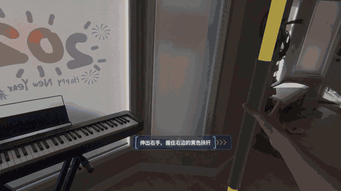
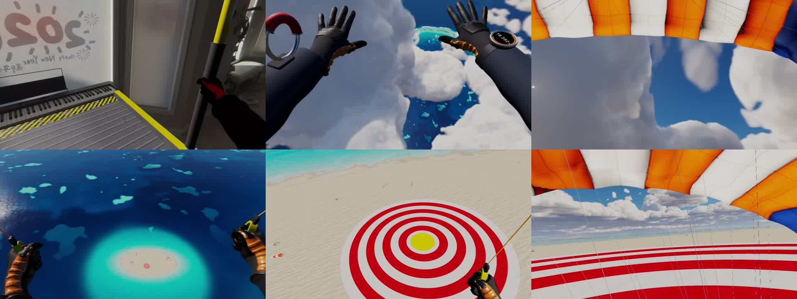

# Freefall

**English · [简体中文](README.zh-CN.md)**

<p align="center">
  <a href="https://alanfeiyuchang.github.io/freefall-support/donate.html"></a>
</p>

A first-person skydiving game for Apple Vision Pro. Jump out of the open ramp of a transport plane at 18,000 feet, fall through
a rain cloud, pull your own ripcord when your wrist altimeter alarms, and fly your canopy onto the red-and-white landing circle on
the ground. Seven worlds: Atoll, Grassland, Alpine, Snow Peaks, Island, Volcano and Sky City.
It starts in your own room: grab the bar beside you, and the plane and the sky grow out from your hand.

Inspired by a screen recording of a web piece called "THIN AIR". Apart from the gloves, everything is generated in real time:
the plane, the canopy, the gear, the clouds, the sea and the sound. The gloves are the hand model from Apple's sample code
(MIT-style license), recoloured as skydiving gloves and driven by your real hands. You grab the bar, the ripcord handle and the
toggles with your real hands, and the altimeter sits on your wrist; tap it and an Iron Man–style helmet HUD appears at the edges of your view.





<sub>All of the above was recorded on Apple Vision Pro (the Atoll world).</sub>

## How to play (about 4 minutes a jump)

1. In the start window, swipe the cards to pick a world and tap **Jump**. Freefall is played only with your real hands; the first time, it asks for hand tracking.
2. You are still in your own room, with a yellow bar beside you. **Grab it**, and the cargo hold of a transport plane grows out from your hand, with the sky beyond the open ramp.
3. When the jump light turns green, **let go** and you're out. Free fall lasts a little over a minute, through a cloud deck that is raining.
4. Your watch alarms at 3,500 feet: **with the watch hand, grab the red handle on your other forearm and pull it out** to open the canopy. Pull too late and you crash.
5. Under canopy, **turn your head and body to steer**; the canopy follows you. Grab the toggles beside your head: pull both to slow down, push them forward to dive.
6. **Land inside the red-and-white circle to win**; the yellow bullseye in the middle is a perfect landing. Tap the watch on your wrist to toggle the helmet HUD; hold it for two seconds to quit a jump.

Every jump has its own wind. Landing on a world's target unlocks its canopy, and hitting the bullseye unlocks its gloves and sleeves;
once you've landed safely in a world you can practice from 5,000 feet; after each jump there's a top-down replay of your flight.
The full gameplay and design notes are in [docs/gameplay.md](docs/gameplay.md) (in Chinese).

## Seven worlds

| World | Landing zone | Watch out for |
|---|---|---|
| Atoll | A white sandbar in a lagoon | Water |
| Grassland | Rolling hills and farmland | The river, the woods |
| Alpine | A meadow in a U-shaped valley | Rock walls, forest |
| Snow Peaks | A snowfield at 2,750 m | Slopes too steep to land on; thin air, so pull early |
| Island | A meadow behind the beach | The sea, the rainforest |
| Volcano | A caldera | Lava, the crater, the ash plume |
| Sky City | A stone city on floating islands above a sea of clouds | Falling off the island, hitting towers and the castle |

## Comfort

Best played seated, with headphones; you never need to walk. By default you steer by turning your head and body, so the world never
spins around you. The optional "+ Toggles" canopy steering does rotate the world, and shows a motion-sickness warning before it's turned on.
The edges of your view darken while turning, and the helmet HUD moves with your head as a fixed frame of reference.

## Build and run

Requires Xcode 27, the visionOS 27 SDK and [XcodeGen](https://github.com/yonaskolb/XcodeGen). The Xcode project is generated from `project.yml` and isn't checked in.

```bash
xcodegen generate && open Freefall.xcodeproj
tools/install-device.sh --launch   # build Release, install on Apple Vision Pro and launch
```

Simulator launch arguments, the offscreen render checks (`tools/render-check`: renders frames, measures performance and runs
autopilot tests on a Mac) and the code layout are in [docs/development.md](docs/development.md).

## Docs

The detailed docs are written in Chinese.

| Doc | Contents |
|---|---|
| [docs/gameplay.md](docs/gameplay.md) | Gameplay and design: wind, the seven worlds, hands and the altimeter, the helmet HUD, languages, sound, motion comfort |
| [docs/development.md](docs/development.md) | Building and running, simulator launch arguments, offscreen render checks, file layout |
| [docs/rendering.md](docs/rendering.md) | Rendering: atmosphere, volumetric clouds, terrain, rain, the opening materialization, Sky City |
| [docs/performance.md](docs/performance.md) | Performance work and measurements on the headset |
| [docs/known-issues.md](docs/known-issues.md) | Known issues and next steps |

## Credits

- The glove model comes from Apple's sample code "[Animating hand models in visionOS](https://developer.apple.com/documentation/visionos/animating-hand-models-in-visionos)"; its license is in `Freefall/Resources/Gloves/LICENSE-Apple-sample.txt`.
- The wind, parachute-opening and canopy-flapping sound effects are by Huggy13ear on freesound.org, CC BY 4.0; see `Freefall/Resources/Audio/CREDITS.txt`.

## Support the project

Freefall is made by one indie developer. If you enjoy it, **[☕ tip the developer](https://alanfeiyuchang.github.io/freefall-support/donate.html)** (WeChat Pay / Venmo) — completely optional, and it doesn't unlock anything in the game.

## License

Source-available under [PolyForm Noncommercial 1.0.0](LICENSE): free to use, study and modify for noncommercial purposes. Third-party assets and code keep their own licenses; see [THIRD_PARTY_NOTICES.md](THIRD_PARTY_NOTICES.md).
