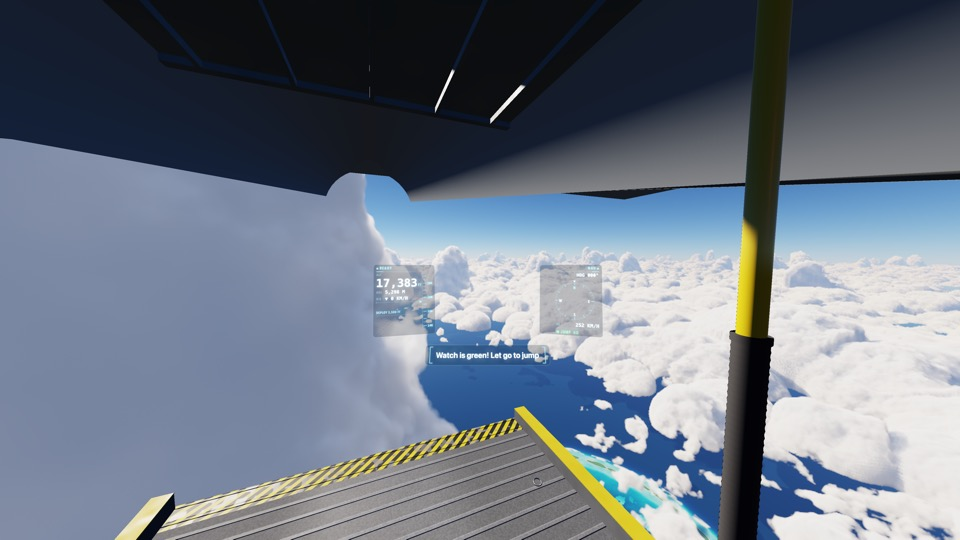
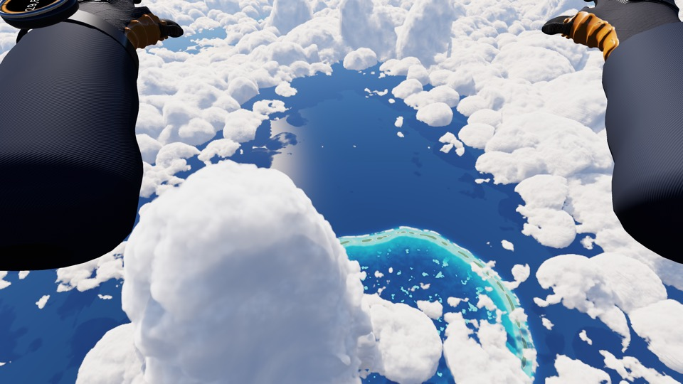
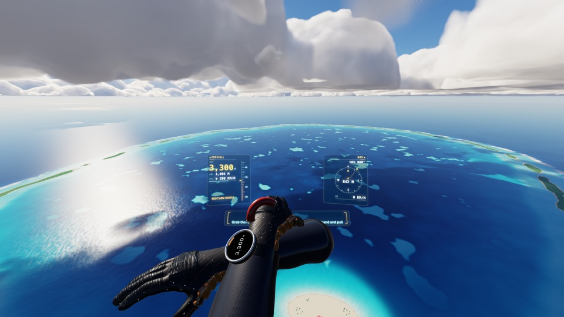
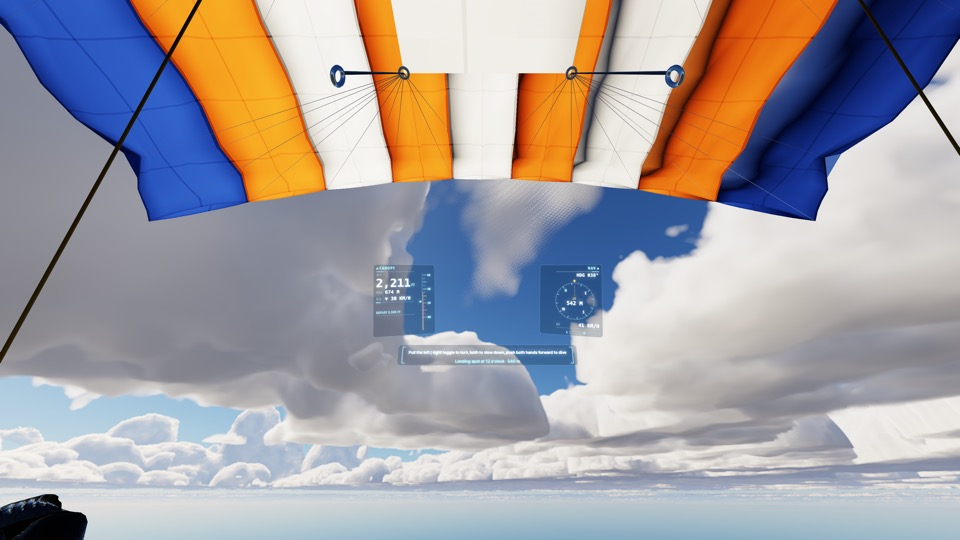
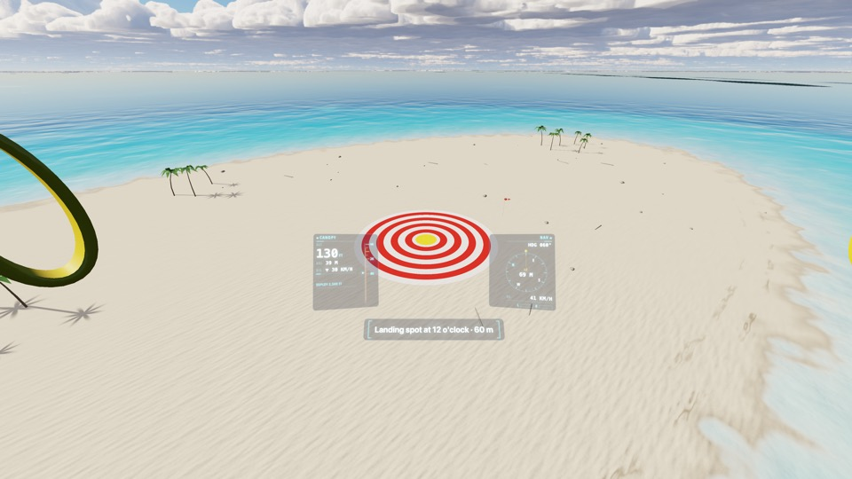
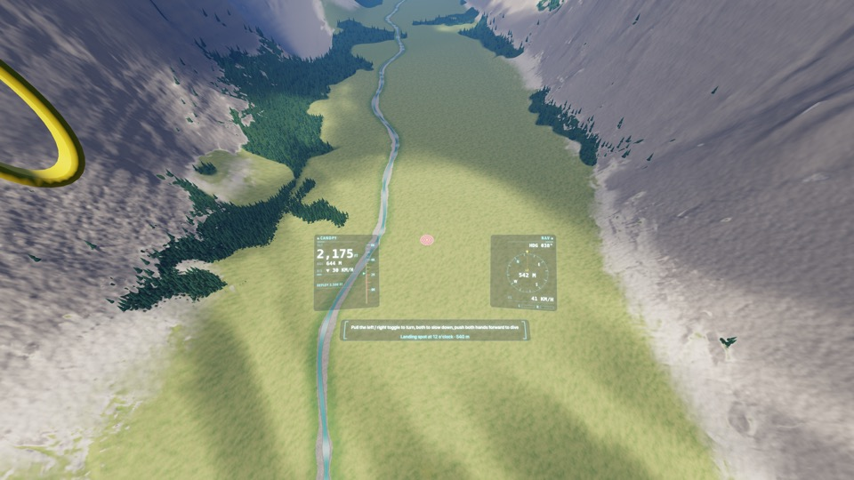
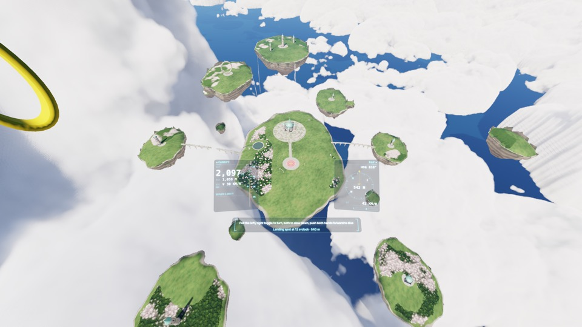

# 截图和预览视频

## 规格（App Store Connect Help，2026-11-13 查）

**截图**（Apple Vision Pro，必填）
- **3840 × 2160 px**（16:9 横屏），`.jpeg` / `.jpg` / `.png`，**不能有透明通道**。
- 每种语言 **1–10 张**。没给某种语言单独上传时，用主语言（English (U.S.)）的那一套。
- 出处：<https://developer.apple.com/help/app-store-connect/reference/app-information/screenshot-specifications/>

**预览视频**（可选）
- 3840 × 2160 横屏，**15–30 秒**，**最高 30 fps**。
- H.264（.mov / .m4v / .mp4，10–12 Mbps，High Profile Level 4.0 以内）或 ProRes 422 HQ（.mov）；立体声 AAC 256 kbps，44.1 / 48 kHz。
- 单个文件 ≤ 500 MB，每种语言最多 3 个；默认封面帧取第 5 秒，可以改；上传后处理最长要 24 小时。
- 出处：<https://developer.apple.com/help/app-store-connect/reference/app-information/app-preview-specifications/>

**visionOS 的拍法**（<https://developer.apple.com/visionos/submit/>）
- 在头显上录之前打开**高质量录制**（Reality Composer Pro → Developer Capture，或 Xcode 的设备截屏的高质量选项），
  否则录到的是注视点渲染后的画面，四周分辨率低。
- 只有玩法靠手势时才让手入镜——Freefall 正是靠手玩的，手和手套应该出现。
- 全沉浸的画面可以不带真实环境。

## 正式截图怎么拍

用**真机**录：画面、手、混合沉浸开场的房间只有真机有。离屏渲染（下面的候选图）用来挑镜头、定构图，也可以在真机录不到满意画面时当备选，
但它的手是合成姿势，开场的「房间」也画不出来。

建议都用**环礁**以外的关轮流出镜，展示七关的变化；每张图上加一行短文案（文案用下面的表，十种语言各一套，
字放在画面上方或下方三分之一、避开 HUD 和手）。录之前在开始窗口把语言切到对应语言，HUD 和提示条也就是那种语言（HUD 读数标签都是英文）。

| # | 拍什么（哪一关、哪个时刻、看哪里） | 候选图 | 文案（英文） |
|---|---|---|---|
| 1 | **开场**：自己的房间里（混合沉浸），握住黄色扶杆的那一刻，青色波前正从手边扫开、货舱长出一半。低头 5° 左右看着扶杆和舱门方向。**只能真机拍** | — | Grab the bar. The plane grows around you. |
| 2 | **绿灯**：环礁，舱门口，跳伞灯刚变绿，提示「绿灯了，松手就跳」，门外是云海和环礁 | `v7_ready` | Wait for green. Let go. |
| 3 | **自由落体**：刚出舱、两臂张开往下看，脚下是云和环礁（或草原的农田） | `f1_exit_down45` | Fall from 18,000 feet. |
| 4 | **穿雨云**：3,000 米左右在雨云里，雾往上掠、雨点划过、手套湿了。离屏渲染的雨云镜头只是一片白，**建议真机拍** | — | Through the rain. |
| 5 | **开伞**：手表报警（橙色），一只手抓着另一只小臂上的红色拉环，HUD 开着显示「开伞！」 | `f5_handle` | Pull your own ripcord. |
| 6 | **伞下**：抬头看伞衣（默认橙白蓝，或者解锁的皮肤伞），抓着两侧操纵环，HUD 显示降落点方位 | `k1_canopy_toggles` | Fly your canopy. |
| 7 | **高山**：伞下顺着 U 形谷往下飞，两边是比你高的山墙，远处靶在草甸上 | `scene2/t6_canopy_target` | Seven worlds to land in. |
| 8 | **火山**：伞下，火山锥、熔岩流和斜着的烟柱在旁边。离屏的两个机位（`t6_canopy_target`、`card`）都看不清烟柱，**真机拍** | — | Steer clear of the lava. |
| 9 | **天空之城**：伞下飞向浮空岛上的石头城，脚下是云海 | `scene6/t6_canopy_target`（合并后浮岛改成多层，要重渲） | Land on a city in the sky. |
| 10 | **皮肤页**：开始窗口里的皮肤转盘，几顶不同关的伞（截窗口，背景是房间）。**合并皮肤那批改动以后才有，真机拍** | — | Earn a canopy for every world. |

第一张最重要（产品页和搜索结果里最先看到）：建议用 1（开场长出飞机）或 3（自由落体）。

### 十种语言的截图文案

| # | en | zh-Hans | zh-Hant | ja | ko |
|---|---|---|---|---|---|
| 1 | Grab the bar. The plane grows around you. | 握住扶杆，飞机在你身边长出来 | 握住扶桿，飛機在你身邊長出來 | バーを握ると、輸送機が現れる | 손잡이를 잡으면 수송기가 나타납니다 |
| 2 | Wait for green. Let go. | 等绿灯，松手 | 等綠燈，放手 | 緑のランプで手を離す | 초록불에 손을 놓으세요 |
| 3 | Fall from 18,000 feet. | 从一万八千英尺落下 | 從一萬八千英尺落下 | 高度18,000フィートから落下 | 18,000피트에서 낙하 |
| 4 | Through the rain. | 穿过雨云 | 穿過雨雲 | 雨雲を突き抜けて | 비구름을 뚫고 |
| 5 | Pull your own ripcord. | 自己拉开伞 | 自己拉開傘 | 自分の手でパラシュートを開く | 직접 낙하산을 펴세요 |
| 6 | Fly your canopy. | 操纵你的降落伞 | 操縱你的降落傘 | キャノピーを操縦する | 캐노피를 조종하세요 |
| 7 | Seven worlds to land in. | 七个地方等你降落 | 七個地方等你降落 | 7つの世界に着地しよう | 일곱 개의 세계에 착지하세요 |
| 8 | Steer clear of the lava. | 躲开熔岩 | 避開熔岩 | 溶岩をよけて | 용암을 피하세요 |
| 9 | Land on a city in the sky. | 降落在天空之城 | 降落在天空之城 | 天空の都に降り立つ | 하늘의 도시에 착지 |
| 10 | Earn a canopy for every world. | 每一关赢一顶降落伞 | 每一關贏一頂降落傘 | ステージごとにキャノピーを獲得 | 세계마다 캐노피를 얻으세요 |

| # | es | fr | de | it | pt-BR |
|---|---|---|---|---|---|
| 1 | Agarra la barra. El avión aparece a tu alrededor. | Saisissez la barre. L'avion apparaît autour de vous. | Greif die Stange. Das Flugzeug wächst um dich herum. | Afferra la sbarra. L'aereo ti cresce intorno. | Segure a barra. O avião surge ao seu redor. |
| 2 | Espera la luz verde. Suelta. | Attendez le vert. Lâchez. | Warte auf Grün. Lass los. | Aspetta il verde. Lascia la presa. | Espere a luz verde. Solte. |
| 3 | Cae desde 18.000 pies. | Tombez de 18 000 pieds. | Fall aus 18.000 Fuß. | Cadi da 18.000 piedi. | Caia de 18.000 pés. |
| 4 | A través de la lluvia. | À travers la pluie. | Durch den Regen. | Attraverso la pioggia. | Através da chuva. |
| 5 | Abre tu propio paracaídas. | Ouvrez vous-même votre parachute. | Zieh selbst deinen Schirm. | Apri tu il paracadute. | Abra seu próprio paraquedas. |
| 6 | Pilota tu vela. | Pilotez votre voile. | Steuere deinen Schirm. | Pilota la tua vela. | Pilote seu velame. |
| 7 | Siete mundos donde aterrizar. | Sept mondes où atterrir. | Sieben Welten zum Landen. | Sette mondi in cui atterrare. | Sete mundos para pousar. |
| 8 | Esquiva la lava. | Évitez la lave. | Weich der Lava aus. | Evita la lava. | Desvie da lava. |
| 9 | Aterriza en una ciudad en el cielo. | Posez-vous sur une cité dans le ciel. | Lande auf einer Stadt im Himmel. | Atterra su una città nel cielo. | Pouse numa cidade no céu. |
| 10 | Gana una vela en cada mundo. | Gagnez une voile dans chaque monde. | Verdiene in jeder Welt einen Schirm. | Conquista una vela in ogni mondo. | Ganhe um velame em cada mundo. |

## 离屏渲染的候选图

```bash
tools/appstore/render_shots.sh            # 出到 build/appstore-shots/scene<N>/<镜头>.png，3840×2160
UILANG=ja tools/appstore/render_shots.sh   # 日文提示（要先编过一次 app）
```

`tools/render-check/main.swift` 加了 `SHOTW` / `SHOTH` 两个环境变量改出图尺寸（默认还是 1280×960）。
下面是缩小的预览（`screenshots/preview-*.jpg`）；4K 原图不进仓库，跑上面的脚本重新出。

2026-11-13 用 release 分支（还没合并皮肤那批改动）渲的。看过以后的判断：

| 预览 | 对应清单 | 能不能用 |
|---|---|---|
|  | 2 绿灯 | 能用：舱门、扶杆、云海、HUD 和「绿灯了」提示都在 |
|  | 3 自由落体 | 构图好；画面中间有一道竖着的海面反光接缝，真机上如果也有，换个角度拍 |
|  | 5 开伞 | 能用：一只手抓着小臂上的拉环，HUD 显示 3,300 ft 和「开伞！」 |
|  | 6 伞下 | 能用：伞衣、伞绳、HUD；合并皮肤以后可以换成一顶解锁的伞 |
|  | 备选：快落进靶 | 能用：环礁沙洲上的红白靶和黄色靶心，适合当「落进靶心」那一张 |
|  | 7 高山 | 可用，但俯视角偏平；真机上抬一点头、让两边山墙更高会更好 |
|  | 9 天空之城 | 好看；但合并后天空之城改成多层浮岛，要重渲或真机拍 |

没出图 / 不能用：雨云里（`r1_rain_in_deck` 只是一片白）、火山（看不清烟柱）、草原 / 雪山 / 海岛（`k*` 镜头只在环礁出图）。

## 预览视频（可选，最多 3 个，15–30 秒）

用真机高质量录制，剪成一条 **25–30 秒**、30 fps、3840×2160 的视频。分镜：

| 时间 | 画面 | 声音 |
|---|---|---|
| 0–4 s | 房间里伸手握住扶杆，飞机从手边长出来、房间化成高空 | 发动机由闷变清 |
| 4–7 s | 绿灯「叮」，松手，滑出跳板 | 风声起来 |
| 7–12 s | 自由落体：先在云海上方，再一头扎进雨云，雨点划过、手套湿了 | 风、雨打头盔 |
| 12–16 s | 手表报警，抓住小臂上的拉环拉出去，抬头看伞衣一格格鼓起来 | 报警、撕扯、开伞 |
| 16–24 s | 伞下三段各 2–3 秒：高山 U 形谷、火山烟柱旁、天空之城（每关一个镜头） | 伞衣抖动 |
| 24–30 s | 拉平，落进黄色靶心，提示条显示结果和新解锁的伞 | 落地、胜利音 |

- 第 5 秒是默认封面帧，正好是绿灯、门外云海那一刻，可以就用它。
- 不要加 App 以外的画面（真人实拍、头显外观）；字幕和片头片尾文字尽量少，以 Apple 当前的预览视频规则为准（上传时 ASC 会提示）。
- `tools/render-check/run.sh … film` 能离屏渲出整段跳伞的预览帧（1280×720、30 fps），可以用来先排节奏，但正式视频用真机录。
